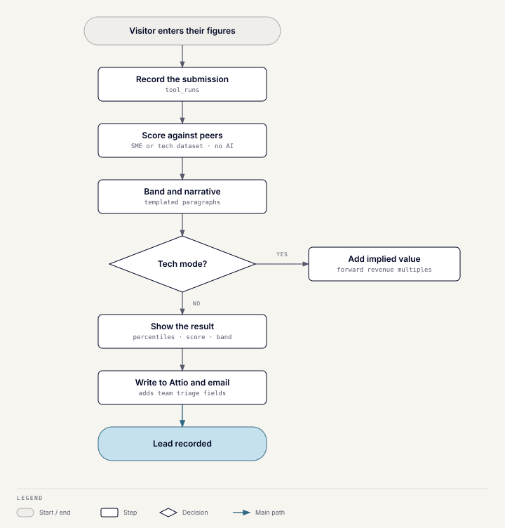

# GCC SME Benchmark

## What it does

A business compares its figures with GCC peers. The visitor sees percentiles
per metric, an overall score and band, and a short narrative. Tech mode also
shows an implied enterprise value. No AI is involved.

## How it works

1. `POST /benchmark` records the submission through the
   [write contract](lead-tools.md#the-write-contract).
2. The figures are scored against the peer dataset in Postgres. SME mode
   compares by sector and revenue band; tech mode compares by sector and
   funding stage.
3. The score maps to a band, from "Top decile operator" down.
4. Templated paragraphs explain the metrics that stand out.

The page offers an AED or USD toggle for entry and display only. Everything
is computed and stored in USD.

## The peer dataset

The peer dataset lives in five tables, owned by the `benchmark_data` module:

- **Peer cuts and anchors:** one peer cut per sector (SME mode) or funding stage (tech mode). Each has a sample size and, for every metric, the p10, p25, p50, p75 and p90 anchors.
- **Revenue bands:** the revenue ceilings and the three factors that shift a sector's anchors for a band.
- **Metric weights:** how much each metric counts towards the score. A mode's weights add up to 100.
- **Dataset version:** one row that goes up by one with every edit.

Advisors read and edit these from Claude through the [Wusool MCP](toolkit-mcp.md). Edits apply at once to new scores. The page itself caches its data for about a minute. Every edit stores who made it and when. The formula that turns anchors into percentiles, scores and bands stays in code.

The page loads its data from `GET /benchmark/20-data.js`, which is built from the same tables. If the database can't be read, that route serves the static copy of the original dataset, and logs the failure.

An edit can change existing peer cuts, bands and weights. It can't add or remove a sector, because each sector is also mapped to a CRM sector option in code.

## Internal triage

The team also gets fields the visitor never sees, on the seller role in Attio.
These are lead priority, routing reason, quality checks, benchmark review,
headline flag, and band.

## Accuracy

The engine was ported from the old browser tool and diffed against it over
about 20,000 generated cases with no mismatches. That comparison caught a
rounding difference: JavaScript rounds halves up, Python to even. The
server uses JavaScript's rounding so scores match what visitors saw before.

## Status

Verified end to end against a real database.

## Code

`server/app/modules/lead_magnets`: the `benchmark` folders under `domain`
and `api`, and `static/benchmark`. The peer dataset tables are in
`server/app/modules/benchmark_data`. `benchmark_dataset.py` and
`static/benchmark/20-data.js` are the seed and fallback copies of the
original dataset; don't edit them by hand. The report copy is also generated.
