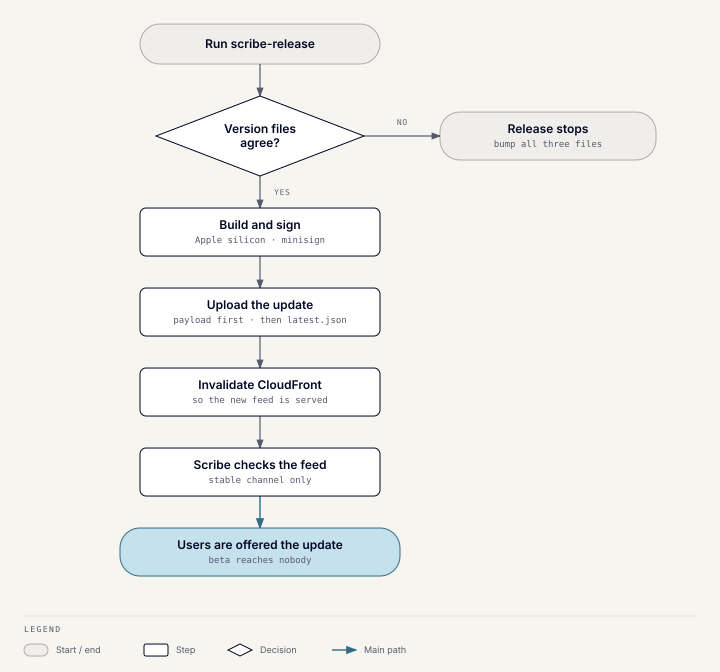
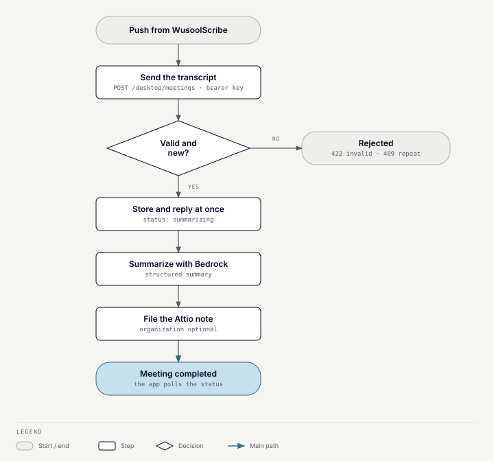

# WusoolScribe

## What it does

WusoolScribe records or imports meetings and transcribes them on the user's
Mac. It writes an editable summary, and can push a finished meeting to the
Toolkit server, which files it in Attio as a note.

## Components

- **Desktop app:** a Next.js interface inside Tauri, with a Rust core. The
  core handles audio capture, Whisper transcription, summary-provider calls,
  local SQLite storage, and the server client.
- **Server side:** the `meetings` module in the Toolkit, behind `/desktop/*`.
- **Update feed:** a private, versioned S3 bucket behind CloudFront, in the
  `scribe-updates` stack.

## Platforms and signing

Only **macOS on Apple silicon** is released. The repository contains code for
Windows and Linux, but no builds are published for them.

- Builds are **ad-hoc signed and not notarized**, because there is no Apple
  Developer account. A first install needs the quarantine flag removed with
  `xattr`, as described in the user guide.
- Because the ad-hoc signature changes with every build, macOS asks for
  microphone and screen-recording permission again after **every update**.
  This is an accepted trade-off.
- Update payloads are signed separately with minisign, and the app verifies
  that signature before installing.
- The webview's Content Security Policy allows inline styles
  (`'unsafe-inline'` in `style-src`), and `tauri.conf.json` sets
  `dangerousDisableAssetCspModification: ["style-src"]`. Without it, Tauri
  adds style hashes to the policy, WebKit then ignores `'unsafe-inline'`, and
  every `style="…"` attribute in the pre-rendered pages is dropped. The
  sidebar, for example, opened at the width of its content instead of the
  saved width. Scripts keep Tauri's hashes.

## Releases and updates



The `scribe-release` workflow is run by hand, choosing a `stable` or `beta`
channel. The version is bumped by hand in three files, and the workflow
checks they agree before building. It then uploads the payload, uploads
`latest.json`, and invalidates CloudFront. The workflow publishes through an
OIDC role scoped to its own GitHub environment.

The app's updater only reads the **stable** channel, so a beta release
currently reaches nobody.

## Data flow

```text
microphone and system audio, or an imported file
  → local recording (mixed track, plus a meeting-audio-only track)
  → local Whisper transcription, tagged "me" (mic) or "others" (system)
  → local speaker diarization of the meeting audio after saving
  → user edits the transcript and names speakers
  → summary provider chosen in Settings
  → local SQLite meeting
  → optional push to the Toolkit server
  → server-side Bedrock summary and Attio note
```

Audio and transcription stay on the Mac. Two summary providers run locally:
Ollama and a built-in model. The online ones are OpenAI, Claude, Groq,
OpenRouter, and a custom OpenAI-compatible endpoint. Remote providers receive the
transcript text when chosen.

## Speaker diarization

Each transcript segment stores a speaker key: `me`, `others`, or
`speaker_N`. Display names are resolved from the meeting's speaker map, so
renaming a speaker changes one row.

- **Live:** the mic and system audio go through separate voice-activity
  detectors. A bleed gate drops mic audio that only echoes the speakers.
- **After saving:** [speakrs](https://github.com/avencera/speakrs), a Rust
  port of the pyannote `community-1` pipeline, runs on `system.mp4`. Each
  `others` segment gets the voice that overlaps it most. ffmpeg decodes the
  track straight to 16 kHz mono, so the audio buffer is about 230 MB per
  hour.
- **Backends:** CoreML by default on macOS, at about 90 times real time with
  a peak of about 2.7 GB. CPU runs at about 15 times real time on Apple
  silicon with a peak of about 0.5 GB. If CoreML fails, that run falls back
  to CPU. The CoreML models download only on request, from Settings or the
  prompt on **Separate Speakers**. Until then, automatic separation after a
  recording runs on CPU, so it never downloads 272 MB in the background.
- **Voice library:** naming a voice stores its embedding in
  `speaker_profiles`. Later meetings auto-name voices whose cosine
  similarity is at least 0.7, and never give two voices the same person.
- **Naming panel:** `get_speaker_overview` returns each voice's line
  count, talk time and a sample line (the longest of its first five).
  Unnamed voices scoring 0.5 or more against a profile not already in the
  meeting get a one-click suggestion. `speaker_voice_clip` cuts up to six
  seconds of the sample line from `system.mp4` with ffmpeg and returns it
  as WAV bytes, played from a `blob:` URL (allowed by `media-src`).
- **Models:** about 32 MB for CPU, plus 272 MB for CoreML. They are
  downloaded once into the app data folder, from a pinned revision of the
  `avencera/speakrs-models` Hugging Face repository (CC-BY-4.0).

Embeddings never leave the Mac. A push sends only the resolved names.

## After a push



1. `POST /desktop/meetings` stores the transcript and returns at once with
   status `summarizing`.
2. In the background, Bedrock writes a structured summary.
3. The server **always** creates an Attio note, with or without an
   organization. The note links to the organization and, when the role has
   an Attio entry, to its buyer or seller role. The server never creates
   organizations.
4. An Attio failure is logged; the meeting still completes on the server.

### Summary format

The summary's `executive_summary` field holds a gist of 2–3 sentences and
60 words at most. The field keeps its old name, so installed apps still show
it; a later release can rename it. Detail goes in `notes`, sized by
`summary_budget` in `server/app/modules/meetings/domain/prompts.py` from the
transcript's word count:

| Transcript | Spoken time | Topics | Gist and notes |
| --- | --- | --- | --- |
| Up to 2,000 words | up to ~13 minutes | 1–2 | ~120 words at most |
| Up to 8,000 words | ~13–53 minutes | 3–4 | ~350 words at most |
| More | over ~53 minutes | 6–8 | ~700 words at most |

The budget is a ceiling: a long meeting with little substance still gets a
short summary. Decisions, action items and claims to verify are never cut to
fit it. The prompt also sets the writing style: British spelling, sentences
of 25 words or fewer, outcome first. It trusts speaker names a user
assigned, but not placeholders such as "Speaker 2", "Others" or "Me".

`render_summary_text` writes the plain text stored in `meetings.summary`,
filed as the Attio note and read by the matching engine. Its order is gist,
next steps, decisions, deal momentum, claims to verify, risks, keywords,
then notes by topic. The matching engine reads each summary whole, never
cut, as context for buyer and seller matching.
Summaries are not regenerated, so older ones keep their long opening.

The Bedrock calls run through Pydantic AI agents
(`server/app/modules/meetings/providers/bedrock/client.py`). Each agent's
output type is a schema, so Bedrock must answer through that tool and the
agent validates the result. A final summary whose gist runs over 75 words,
or with a note point over 35, gets one retry; after that it is accepted.
Transient AWS errors are retried up to three times. Logs and stored failure
reasons hold error codes only, never model output.

A push for the same install and recording always returns 409, so pushing
again doesn't recover a failed meeting. Instead, a meeting stalled for 10
minutes is reset the next time its status is read, which re-runs the
summary.

### Proofread

`CorrectionService` (`server/app/modules/meetings/application/corrections.py`)
splits a transcript into batches of about 12,000 characters, four at a time.
Each batch numbers its lines from 1, so the model returns short line numbers
instead of segment ids and never repeats the original text. The two lines
before a batch go along as read-only context.

The system prompt holds the rules and a default vocabulary of deal, finance
and GCC terms (`domain/vocabulary.py`). It is the same for every batch, so
Bedrock caches it. The user's own words, the speaker names and the meeting
title arrive per request, trimmed and capped.

The server drops a suggestion for an unknown line, a repeat or no change. It
also drops a rewrite: more than three changed words or 40% of the line, or a
switch between Arabic and Latin script. Letters spoken one at a time count as one
word. It reports the stored text as `original`, which the app checks before
applying a fix.

`CORRECTION_MODEL_ID` and `CORRECTION_MAX_TOKENS` set the model and output
budget. `evals/eval_proofread.py` scores models against labelled excerpts.
On 19 errors, Sonnet 4.6 caught 18 with no false fixes. Haiku 4.5 caught 17
with none, in about two thirds of the time.

## Interfaces

Every `/desktop/*` call needs the shared desktop API key as a bearer token,
compared in constant time.

| Endpoint | Purpose |
| --- | --- |
| `GET /desktop/verify` | Checks the server address and key before Settings saves them. |
| `POST /desktop/meetings` | Accepts a transcript. Over 1.5 million characters returns 422; a repeated install and recording returns 409. |
| `GET /desktop/meetings/{meeting_id}` | One meeting's processing state and summary. `summary_text` is the same rendered text filed as the Attio note; the app writes it to `summary.md`. |
| `GET /desktop/meetings?install_id=…` | Meetings for an installation; 200 by default, at most 500. |
| `GET /desktop/companies/search` | Searches CRM organizations to link a meeting to. |
| `DELETE /desktop/meetings/{install_id}/{local_recording_id}` | Removes a meeting from the server and Attio; returns 204. |
| `POST /desktop/transcripts/corrections` | Sends transcript lines, with speaker names and optional `context` (title, names, the user's vocabulary), to Bedrock for spelling suggestions. Returns each fix with a category, plus `failed_segment_ids` for lines in batches that errored. Nothing is stored. |
| `POST /desktop/feedback` | Records in-app feedback and emails the team. |

Internal Tauri commands aren't a public integration API.

## Deleting a meeting

Deleting from the server is idempotent. It returns 409 while the meeting is
still being summarized, unless it has stalled. It deletes the Attio note
first, then marks the server's note and meeting rows as removed; nothing is
hard-deleted. Publishing and deleting a meeting each record an activity
(`meeting.published`, `meeting.deleted`) attributed to the Scribe install.

## Feedback

Feedback is written to `feedback_submissions` first, so a 200 means it was
kept. Categories are bug, feature request, transcription quality, and other;
messages are capped at 4,000 characters. Limits are five per install and 20
per IP address, with 429 beyond that. The SES email to the team is
best-effort and is only sent when a sender and recipient are configured.

## Failure behavior

- Recordings and drafts are stored locally, so a network failure never loses
  a meeting.
- Transcription failures stay local and can be retried.
- A failed remote summary doesn't affect the local transcript.
- If diarization fails or the meeting has no meeting-audio track, segments
  keep the `others` label. The meeting is saved either way.
- On the server, authentication, summarization, and Attio filing are
  separate stages; the app polls for the result.

## Code

The app is in `scribe-desktop/`; the server side is
`server/app/modules/meetings`. The release workflow is
`.github/workflows/scribe-release.yml`, and the update feed is
`infrastructure/terraform/stacks/scribe-updates`.
