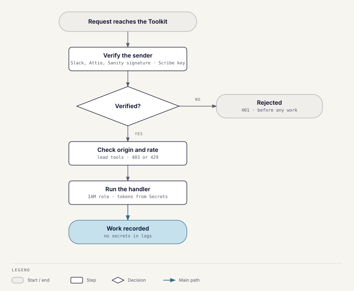

# Security and data handling

## Trust boundaries

| Boundary | Control |
| --- | --- |
| Slack → Toolkit | Slack Bolt verifies every request signature. |
| WusoolScribe → Toolkit | Every `/desktop/*` call needs the shared desktop key as a bearer token, compared in constant time. |
| Attio → Toolkit | Webhook signature check (401 on failure); events from another workspace are dropped. |
| Sanity → Toolkit | HMAC-SHA256 signature with a timestamp (401 on failure); signatures older than 10 minutes are rejected as replays. The endpoint returns 503 until it is configured. |
| Website → lead tools | An allowlist of website origins (403 otherwise) and per-IP rate limits (429). There is no CORS middleware. The allowlist is off if left empty. |
| Readers → gated reports | A 6-digit emailed code, then an HTTP-only reader cookie that lasts a year. Report and PDF reads have per-IP limits but no origin check. |
| Toolkit → Sanity, Webflow, Attio, research APIs | API tokens held only in Secrets Manager. |
| Toolkit → Bedrock, SES | The instance's IAM role; no static keys. |
| Internet → AWS | Security-group allowlists and HTTPS terminated by Caddy. |
| Operators → instances | Systems Manager; SSH is closed. |

## Credentials and access

Application secrets live in AWS Secrets Manager and are read by each
instance's role at startup, so no secret file sits on the instance. Developers
use the same path with their own AWS sign-in and can read the dev secret only.
The app's database login can read and change data but not the schema. Only
the deploy pipeline and admins hold the master login.

Development and production share one AWS account, so an explicit deny, not a
separate account, keeps developers away from the production secret.
GitHub Actions uses AWS OIDC roles, never committed keys. Local `.env` files
hold only non-secret settings and are never committed.

The Toolkit has no user allowlist: anyone who can use the bot in its Slack
channels can run its commands. Slack app installation and channel membership
are the authorization boundary.

The Toolkit's role can send SES email from any verified identity.

## Rendering editor content

Reports are drawn in headless Chromium, which runs editor-supplied HTML and
JavaScript. To contain that:

- all network access from the page is blocked;
- only allowlisted Google Fonts and Sanity CDN images are fetched, by the
  server rather than the page;
- each render runs alone, with a 30-second cap.

Insights article bodies are sanitized with an allowlist of tags, and links
may only use `http`, `https`, or `mailto`.

## Account-level controls

- **GuardDuty and Security Hub** send findings to an email-only security
  topic.
- **AWS Chatbot** posts infrastructure alarms to Slack. Security findings go
  by email only.
- **IAM Identity Center** signs people in with MFA and seven-day sessions. The
  Developer role is denied the production secret.
- **CloudTrail** runs per environment, across regions, with log-file
  validation.
- RDS and EC2 volumes are encrypted. OpenTofu state is in an encrypted,
  versioned S3 bucket.

## Data handling by product

### Wusool Toolkit

Buyer, seller, meeting-note, and match data is read from PostgreSQL and
Attio. Requirement extraction, discrepancy notes, shortlist reasoning,
enrichment, and meeting summaries go to Bedrock. Firecrawl, Diffbot, and
People Data Labs receive company lookups. Discovery sends industry and
geography terms to Google Places and the Geocoding API.

### WusoolScribe

Recording and transcription run on the Mac. Content leaves it when the user
picks a remote summary provider or pushes a meeting. The server keeps pushed
meetings and notes, and creates an Attio note. Transcript lines sent for
spelling corrections go to Bedrock and aren't stored. Feedback is stored in
`feedback_submissions`.

### Website lead tools and reports

Submitted identity, company, financial, questionnaire, and consent data is
recorded in `tool_runs` before anything else happens. Relevant inputs go to
Bedrock or Firecrawl, then to Attio. Report readers are recorded in
`tool_runs` with their name, email, company, and the report, but only after
confirming their code. Test submissions are always flagged.

PostHog (EU Cloud) receives usage events from the tools and reports. It never
receives a form value. A visitor's name, email and company reach it only if
they accepted tracking. A visitor who declined is counted anonymously.
PostHog is a processor under a signed
data processing agreement, and a deletion request must also delete the person
in PostHog.

## Logging and examples

CloudWatch receives selected system, bootstrap, and access logs. Application
logs must never contain bearer tokens, provider keys, transcript bodies, or
personal or financial payloads. The Toolkit's bootstrap turns off shell tracing
before reading its secret, so values never reach SSM history or CloudWatch.

A database error's message can quote the row that failed, such as an email in
a duplicate-key error. The Toolkit's log formatter therefore writes database
errors as their type, SQLSTATE, and constraint name only. It drops every message
in an exception chain that contains one. The database engine also hides bound
parameters, and stored error fields follow the same rule.

Documentation, tests, screenshots, and support messages use synthetic or
redacted people, companies, credentials, transcripts, and figures.

## Security failure behavior

- Failed signatures and authentication are rejected before any processing.
- If the app can't read its secret at startup, it doesn't start. A secret
  edit changes nothing until the container restarts.
- Missing optional provider credentials turn that provider off. Missing
  Slack, database, Attio, or desktop credentials stop the affected feature.
- Lead tools return 403 for a disallowed origin and 429 at the rate limit.
  The Sanity webhook returns 503 until it is configured.
- A wrong test-mode setting is a data-isolation incident: stop writes, keep
  the evidence, correct the setting, and reconcile the affected records.
- Host alarms don't prove that syncs, workflows, AI calls, or leads
  succeeded; check those separately.
