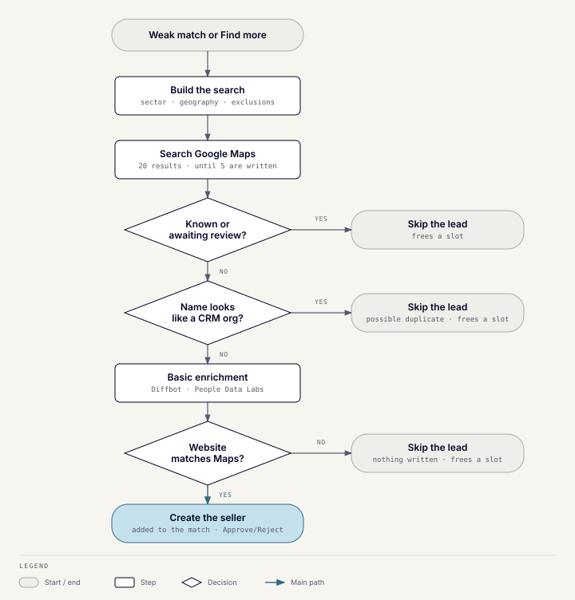

# Seller discovery

## What it does

When matching finds no strong CRM seller, discovery searches Google Maps for
companies that fit the buyer. It checks each against the CRM and adds the
verified new ones as sellers, which people approve or reject like any other
match. Discovery never writes to the CRM itself: it hands every lead to
[profile commands](toolkit-profile-commands.md).

## When it runs

- **Automatically**, when every CRM candidate in a match scores below the
  discovery threshold.
- **On demand**, with **Find more sellers** on the match result.

Each match run searches once; a second trigger is ignored. Each buyer role
gets at most 10 searches a day, not counting searches that fail or find
nothing. The cap is held in memory, so it resets on deploy.

## How it works

### 1. Build the search

The search terms come from the match run's extracted requirements:

- **Industry:** the first sector requirement.
- **Geography:** every geography value, combined, so the search covers the
  union of the buyer's regions and countries.
- **Exclusions:** every excluded sector, used later as a filter, because
  Google Maps search has no reliable "not" syntax.

If no sector or geography was extracted, the buyer's ideal-target
description or strategic thesis is used instead, cut to eight words. Maps wants
a type of business, not a sentence.

### 2. Search Google Maps

One Places Text Search call runs `"<industry> companies <geography>"`, with a
15-second timeout. It asks for up to 20 results at the same price as one. It
requests only name, website, address, and business type.

Geography becomes a search area first:

- **GCC, MENA, and MENATP** resolve from a fixed country table. Geocoding
  them is actively wrong: "GCC" geocodes to a college in California.
- **"Global"** means no restriction.
- **Anything else** is geocoded live. Only real places are accepted
  (countries, regions, cities, or areas like "Middle East"), never a
  business that happens to share the name.

Results outside the resolved countries are dropped. A result with no country
is kept and logged, not discarded unchecked. Excluded sectors are
then filtered out by name and category.

### 3. Check each lead against the CRM

Leads are checked in order until five sellers are written or results run out:

| Check | Result |
| --- | --- |
| Same Google place ID as an organization | Skipped: already in the CRM |
| Same website domain (with or without `www.`) | Skipped: already in the CRM |
| Name resembles an organization (fuzzy match, see below) | Skipped and counted as a possible duplicate. It doesn't use up a slot |
| Already waiting for a website review, flagged in the last 30 days | Skipped, so it isn't researched or posted twice |
| No match | Goes on to enrichment |

A skipped lead, including a possible duplicate, frees its slot. The search
keeps going until it has five new leads or the 20 results run out.

**How names are compared.** A loose database search finds organizations with
similar names. A second check ignores generic words such as "Intelligence",
"Capital", "Solutions", "GmbH", "KG", and "Ltd". The distinctive words that
remain must all appear in the other name, or the names must reach a trigram
similarity of 0.5.

One short word isn't enough: "Noor" doesn't match "Noor Trading", but
"Savvytec" matches "Savvytec Trading". Business-line words such as "Ventures"
or "Partners" still tell firms apart, and a name with no distinctive words is
compared in full. The list is `GENERIC_WORDS` in `discovery/domain/names.py`.

### 4. Basic enrichment

New leads get the [basic enrichment tier](toolkit-enrichment.md#basic-tier):
Diffbot and People Data Labs only, given the company name and its Maps
domain. Two leads are researched at a time, within a 45-second budget for the
whole run, shared by every round. A lead that runs out of time is created from
its Google Maps details alone and marked as such.

### 5. Check the website

Each provider whose data would be saved must report a homepage matching the
lead's Maps website. A match is the same host, ignoring `www.`, or a
subdomain of it. This catches a provider that resolved the name to a different company.

- **All match, or nothing from a provider is used:** the seller is created.
- **Any mismatch, or no website to compare:** nothing is written. The lead is
  skipped and counted, and the next lead takes its slot.

A lead whose write fails is also replaced by the next one, and the failure is
still reported. A skipped lead isn't recorded, so a later search may repeat
its research.

Pages on shared platforms count as no website, because they name the
platform, not the company. Examples are Instagram, Facebook, LinkedIn, Google
Sites, WordPress.com, Wix, and Shopify, as well as link shorteners.

### 6. Create the seller

A verified lead becomes a new organization and seller role in one Attio-first
write, the same path `/add-seller` uses. The write happens under a lock that
re-checks the CRM first, so two leads from the same company can't both be
created. The Google place ID is saved on the organization, so later searches
skip it.

## What appears in Slack

| Message | What people can do |
| --- | --- |
| **Discovered sellers**, created and added to the match run | **Approve** or **Reject**. These sellers are labelled "Discovered via Google Maps; not scored". |
| Failures and counts | Leads that failed to save, and what reached the CRM. Counts of leads skipped as already in the CRM, possible duplicates, website mismatches, or awaiting an older review. Add a skipped duplicate by hand with `/add-seller`. |

## Approve or reject a discovered seller

**Approve** follows the normal approval path. It creates a Qualified Buy-side
deal in Attio for the buyer and seller, or offers to promote an existing
Lead deal. It then starts **full enrichment** in the background, posting a
research proposal for the new seller. Nothing in it is saved until someone
uses **Review & Save**.

**Reject** records who decided and when. The seller stays in the CRM, because
it was created when discovered. Like any rejected match, it isn't suggested
again for that buyer and vertical; other buyers still see it. The CRM owner
removes an unwanted seller in Attio.

Basic enrichment runs while the lead is discovered and uses only Diffbot and
People Data Labs. It is saved with the new seller if the website check
passes. Full enrichment runs after approval, or with `/enrich-seller`. It adds
a Firecrawl web search with Bedrock extraction and returns a proposal only,
saved after review. The costly research is spent only on wanted sellers.

## Data it reads and writes

Discovery owns one table, `discovery_reviews`, for leads awaiting a website
review. Profile commands write the sellers themselves.

## Failure behavior

- Without Google Places credentials, discovery is disabled and says so.
- If the review store is down, the lead's card uses a short-lived button
  instead, and that lead isn't deduplicated next time.
- An in-process lock serializes seller creation, another reason the Toolkit
  runs as one instance.

## Code

`server/app/modules/discovery` and its README. The search terms are built in
`matching_engine/application/discovery_bridge.py`, and the seller write is in
`ddl_commands/providers/discovery`.
