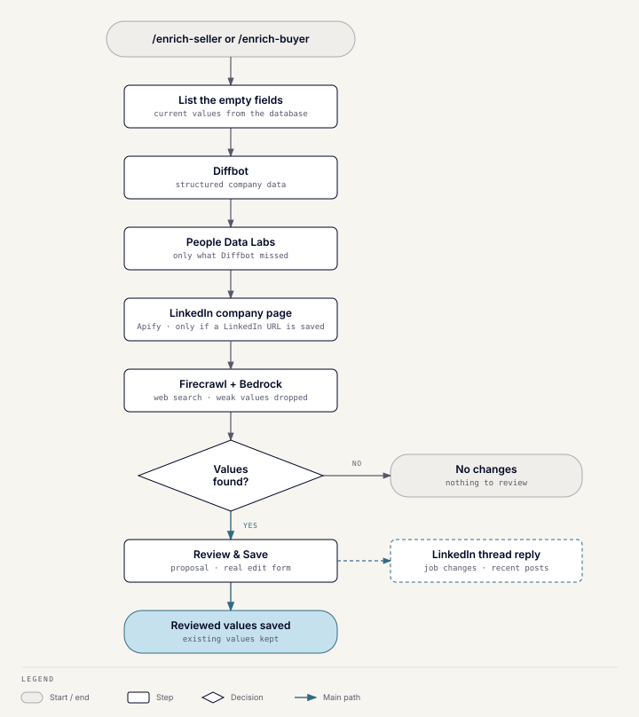

# Enrichment

## What it does

`/enrich-seller` and `/enrich-buyer` research public sources and propose values
for a role's empty fields. Enrichment never saves anything: **Review & Save**
opens the real edit form, prefilled, and the save follows the normal
[profile commands](toolkit-profile-commands.md) path.

## How it works

For a seller, four sources are tried in order. Each is asked only about the
fields the previous ones didn't resolve, and the first answer for a field is
final:

1. **Diffbot:** structured company data such as revenue, headcount,
   locations, founding date, description, headquarters, and social links.
2. **People Data Labs:** the same kind of data, as a second source for what
   Diffbot missed.
3. **LinkedIn company page (Apify):** description, headquarters country,
   headcount band and founding year. It runs only when the organization
   already has a LinkedIn URL and fields are still missing, because each run
   is billed. It never proposes the logo: LinkedIn's logo links expire.
4. **Firecrawl and Bedrock:** a public web search, with Bedrock extracting
   values from the results. This is the last resort.

For a buyer, the first three are asked only about the organization's fields.
Neither provider covers the buyer role's own fields, so those go straight to
the web search. They include investment strategy, target regions, check
sizes, and deal structure.

For a buyer, the command asks for the organization and then the vertical,
because each vertical is a separate buyer role. A buyer with one vertical
skips that step. Enrichment has no free-text note; only `/check-buyer` and
`/find-match` take one.

The research runs in the background. The result message lists every proposed
value with a confidence level and one **Review & Save** button. After the
edit form is saved, the button becomes "✅ ADDED by" the person who saved it.

## LinkedIn activity

After the proposal is posted, the bot replies in its thread with the
organization's recent LinkedIn posts: up to 10, from the past month. Only the
organization's own LinkedIn page is scraped. People are not scraped, so there
are no job changes yet. If the organization has no LinkedIn page saved, the
scan is skipped. A company page's posts are mostly its reposts, so the author
shown is the person who first posted.

The reply comes after the proposal, so a slow or failing scrape never delays
the proposal. Nothing is written to the CRM fields from it.

Each scan is remembered. One run record is saved per scan, and each new post
is saved as a signal linked to it. Every scan also adds one "LinkedIn scan
completed" entry to the activity history, with counts only, even when nothing
was found. It names the person who ran the command, or the system. A scan
that fails is stored as failed.

A re-run shows only what is new, and says nothing if nothing is. A scan
skipped for a missing LinkedIn page is not recorded.
Names and post text live in the signals, so a removal request deletes them
there; the activity history never holds them.

Without an `APIFY_API_TOKEN`, the whole LinkedIn source is skipped.

Each Apify run logs its actor, item count, duration and outcome, which is the
cost signal. The scrapers are the HarvestAPI actors on Apify, called with a
60-second overall cap.

## Basic tier

Seller discovery uses a lighter version that asks only the two structured
providers (Diffbot and People Data Labs, never LinkedIn). It passes the company's domain when known, so a shared name
resolves to the right company. Each provider also reports the homepage of the company it
matched; discovery compares that with Google Maps before saving a lead.

## Failure behavior

- A provider without credentials is skipped; the others still run.
- A rate-limited response is logged as such, and retried once when the wait
  is short.
- Existing non-empty fields are never proposed over.
- Web-search values below 0.6 confidence are dropped rather than shown.

## Data it reads

Current values from `seller_roles`, `buyer_roles`, `organizations`, and
`person`. Apart from the LinkedIn history above, it writes nothing.

## Known gaps

- The People Data Labs response format hasn't been verified against a live
  account yet. Diffbot's has.
- The company and posts formats were checked against a live Apify run. The
  profile scraper's format hasn't been.
- A company page's "posts" are its reposts of other people's posts, so the
  author shown is the original poster.
- A vendor error that returns nothing looks like "no posts". Only a crash or a
  timeout is recorded as failed.
- The free Apify plan limits the profile scraper to 50 runs in total. Only the
  unwired people path uses it. Set a monthly spend cap regardless.

## Code

`server/app/modules/enrichment` and its README.
