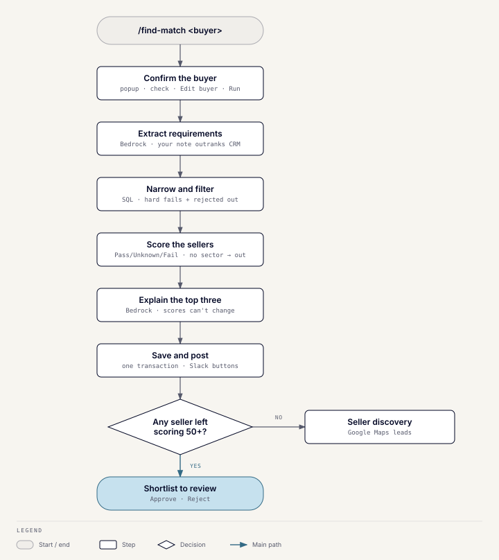
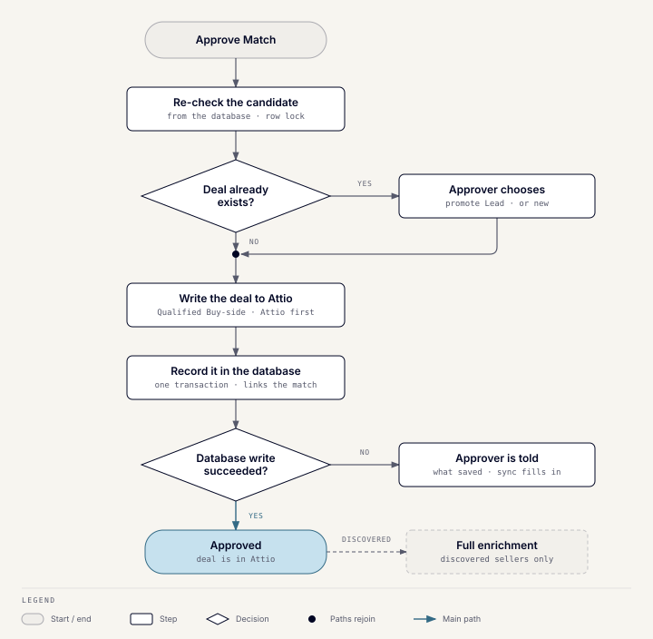

# Matching engine

## What it does

`/find-match <buyer>` produces a ranked seller shortlist for a buyer, explains
it, and lets an advisor approve or reject each candidate. Approving creates a
Qualified Buy-side deal in Attio.

## How it works

1. **Resolve the buyer.** A fuzzy name search finds the buyer, and a popup
   asks the advisor to confirm it, even when there is only one match.
2. **Check the buyer.** The [discrepancy check](toolkit-discrepancies.md)
   fills the same popup. The match starts when the advisor clicks **Run
   anyway**, which works even before the check has finished. **Edit buyer**
   lets them fill missing details without leaving Slack.
3. **Extract requirements.** One Bedrock call reads the buyer's CRM fields,
   free text, recent meeting notes, and the advisor's note. It returns hard
   requirements and soft preferences. The advisor's note outranks every stored
   value. A sector, geography, or limit it names replaces the stored one for
   this run. The buyer organization's own sector interests never count as
   requirements. A ticket or EV limit counts only when the note names what it
   measures. A bare "up to 10M" sets no limit, and the result says so.

   Sectors are always CRM sector options. The prompt splits the advisor's
   phrase into the *core business* (the noun) and *modifiers* (AI, digital,
   Sharia-compliant). The core becomes the hard sector, with one row per
   alternative. Modifiers become soft preferences that only rank.

   "AI asset managers" requires Asset Management or Family Office / Wealth
   Management and ranks AI / ML higher. In "AI tools for asset managers" the
   order flips. A sector outside the CRM list is dropped and logged.

   Code also demotes a modifier sector (AI / ML, Technology, Sharia-Compliant)
   kept next to a core sector, unless the phrase is relational ("for",
   "serving"). The model also returns a short `search_phrase` for the Maps
   search. It is kept only when the advisor named a business type.
4. **Narrow and filter.** SQL narrows sellers by the buyer role's vertical,
   target region and country, and EV ceiling. Hard sector values are OR-ed
   alternatives, like geography. A seller with no data for a dimension passes
   this step. Seller organizations already rejected for this
   buyer role are left out, even under a duplicate seller profile; other
   buyers and verticals still see them.

   If any target region can't be resolved, or is unrestricted (such as Europe
   or Global), geography narrowing is skipped. A seller is then dropped only
   on a confirmed hard requirement's failure; missing data never eliminates
   anyone. Ticket size never eliminates; it only affects the score.
5. **Score.** Each criterion scores Pass 100, Unknown 50, or Fail 0, and the
   weighted average ranks the sellers. Soft sectors are scored as alternatives
   and use the weight of the one that matched. Data confidence (how much of the
   score rests on CRM data rather than AI inference) is reported separately and
   never changes the ranking.

   **Relevance gate.** Before the top three are picked, a seller with no
   sector Pass is dropped whenever the run has a hard sector. Unknown scores
   a neutral 50, which says nothing about relevance, so sellers with no sector
   data can't fill the shortlist. If the advisor named a business type that
   maps to no CRM sector, nothing in the CRM can verify it, so no sellers are
   shown.
6. **Explain.** The top three sellers form the shortlist. One Bedrock call
   writes reasoning for them. It can't change their scores, and its prompt
   tells it to use only the facts it was given.
7. **Save.** Scores, candidates, and the completed run are committed in one
   transaction, then posted to Slack with **Approve**, **Reject**, **View Full
   Analysis**, and **Find more sellers**.
8. **Discover.** If no candidate remains, or every candidate scores below the
   discovery threshold, [seller discovery](toolkit-discovery.md) runs
   automatically. It searches the `search_phrase` when there is one (for
   example "AI wealth management") rather than only the first sector. An empty
   run skips the reasoning call. Otherwise
   **Find more sellers** runs it on demand. Each run searches once.

Meeting notes reach both Bedrock calls as labeled, unverified context: always
for the buyer, and by default for shortlisted sellers. Each summary is capped
at `MEETING_NOTES_MAX_CHARS` (default 3,000). A longer one keeps its first
two thirds and its last third, with a `[middle truncated]` marker, so next
steps at the end survive. Each prompt gets at most
`MEETING_NOTES_MAX_TOTAL_CHARS` (default 12,000) of notes, newest first. The
oldest is always kept, and the prompt says how many older meetings were
omitted.

## What the advisor's note controls

The note can replace stored values and change the shortlist, but only through
the engine's registered criteria. See
[the advisor's note in a match](toolkit-matching-note.md) for what it controls
and what it can't.

## Approving a match

Approve and Reject re-read the candidate from the database rather than
trusting the Slack payload. A compare-and-set on its pending status stops two
people deciding the same candidate. Approve also locks the row, so a double
click can't create two deals.

Approve writes the Qualified Buy-side deal to Attio first, then records it in
the database in one transaction, with a `match.approved` activity for the
approver. A changed deal stage is also recorded in `deal_stage_events`. If
Attio already has a deal for that buyer and seller, the approver chooses to
promote it or create a new one. Only an Inbound deal is promoted.

## Web API

The web app (`client/`) runs the same flow in a browser. The Toolkit container
serves its build at `/app` (`SpaStatic`, which falls back to `index.html` for
deep links and caches hashed assets for a year) and its API under `/api`:

| Route | Does |
| --- | --- |
| `GET /api/buyers?q=` | Buyer search. |
| `POST /api/buyers/{id}/preflight` | Discrepancy check against the advisor's note. |
| `POST /api/match-runs` | Starts a run and returns 202 with its id. |
| `GET /api/match-runs/{id}` | Run state, candidates with reasoning, discovery progress. |
| `POST /api/match-runs/{id}/discovery` | Starts discovery by hand. |
| `POST /api/match-runs/{id}/candidates/{cid}/approve` | Approve, with the promote or create choice. |
| `POST /api/match-runs/{id}/candidates/{cid}/reject` | Reject. |
| `GET /api/match-runs/{id}/export.csv` | The candidates as CSV, with formula characters neutralised. Repeat `fields` to choose and order columns; without it, all are exported. |

**Access.** Every route needs `Authorization: Bearer <WEB_API_KEY>`. A wrong
key gets 401; while the key is unset, every route returns 503. Decisions are
recorded with `approved_by` set to `web`, and runs have no `requested_by`,
until sign-in with Slack exists.

**Runs.** The route commits the run's header row (`start_run`) and returns.
The matching itself (`execute_run`) runs on the shared in-process task runner,
as Slack's runs do. A run with no `completed_at` reads as running. After
`MATCH_RUN_STALE_AFTER_MINUTES` (default 15) it reads as stale: a deploy or
restart cut it off.

**Parity with Slack.** The run detail carries the requirement profile as
`mandate` and each scored candidate's `criteria`, the two parts of View Full
Analysis. Each candidate also carries `profile`, read from its organisation
and seller role. Approving a discovered seller queues the same full
enrichment Slack does and posts it to `WEB_REVIEW_CHANNEL_ID`. With that
setting unset the step is skipped. The profile check can't be skipped.

**One search per run.** Slack and the web claim a run's search outside the
CRM on the run row. A second click, a retry or a restart can't search
twice. The outcome and notes stay on the row, so the run page shows them
after a restart. A search that had nothing to search on, hit the daily cap or
failed releases its claim. It can then run again.

**Discovery.** Below `WEB_FALLBACK_MIN_SCORE`, a web run starts discovery
itself. Its progress and outcome counts live in an in-process tracker; after a
restart the page offers the manual start instead. The manual start is also
offered on runs that cleared the threshold.

**Settings.** `WEB_API_KEY` is a field of the Toolkit secret in Secrets
Manager and must be added by hand to `/wusool/dev/toolkit` and the production
secret. `WEB_ALLOWED_ORIGINS` (CORS) stays empty while the app is served from
the same host.

**Build and deploy.** The Toolkit image has a Node stage that builds
`client/`, passed in as a named build context (`--build-context
client=client` in `_build.yml`, `additional_contexts` in
`docker-compose.yml`). Changes under `client/**` trigger the deploy workflows.
The `Client quality` workflow checks types, lint, tests, the build, and that
the generated API client matches the server.

## Data it reads and writes

| Data | Use |
| --- | --- |
| `buyer_roles`, `seller_roles`, `organizations` | Read: buyer criteria and the seller pool. |
| `meetings` | Read: recent meeting notes as context. |
| `match_scores`, `match_results` | Written: one run and its candidates. |
| `activities`, `deal_stage_events` | Written: a `match.run_completed`, `match.approved`, or `match.rejected` event, and any stage change. |
| `deals` and the Attio deal | Written on approval. |

## Failure behavior

- If requirement extraction or reasoning fails, the run stops with an error
  instead of producing a partial result.
- If Attio accepts the deal but the database write fails, the approver is
  told what was saved. The Attio webhook or nightly resync fills in the
  database.
- Duplicate Slack deliveries are ignored for five minutes by an in-memory
  store. It works for one process only, which is one reason the Toolkit runs
  as a single instance; the auto-scaling group is fixed at one.

## Not built

Semantic search, document ingestion, outreach or email, and PDF output are
out of scope by design.

## Code

`server/app/modules/matching_engine` and its README.
