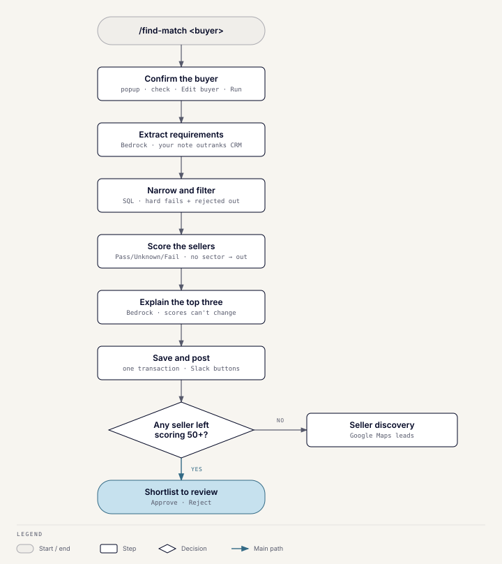
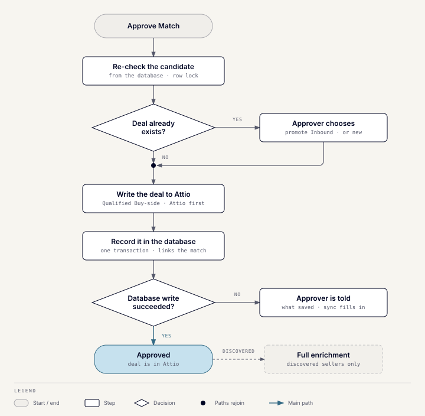

# Matching engine

## What it does

`/find-match <buyer>` produces a ranked seller shortlist for a buyer, explains
it, and lets an advisor approve or reject each candidate. Approving creates a
Qualified Buy-side deal in Attio.

## How it works

1. **Resolve the buyer.** A fuzzy name search finds the buyer, and a popup
   asks the advisor to confirm it, even when there is only one match.
2. **Check the buyer.** The [discrepancy check](toolkit-discrepancies.md)
   fills the same popup. The match starts when the advisor clicks **Run
   anyway**, which works even before the check has finished. **Edit buyer**
   lets them fill missing details without leaving Slack.
3. **Extract requirements.** One Bedrock call reads the buyer's CRM fields,
   free text, recent meeting notes, and the advisor's note. It returns hard
   requirements and soft preferences. The advisor's note outranks every stored
   value. A sector, geography, or limit it names replaces the stored one for
   this run. The buyer organization's own sector interests never count as
   requirements. A ticket or EV limit counts only when the note names what it
   measures. A bare "up to 10M" sets no limit, and the result says so.

   Sectors are always CRM sector options. The prompt splits the advisor's
   phrase into the *core business* (the noun) and *modifiers* (AI, digital,
   Sharia-compliant). The core becomes the hard sector, with one row per
   alternative. Modifiers become soft preferences that only rank.

   "AI asset managers" requires Asset Management or Family Office / Wealth
   Management and ranks AI / ML higher. In "AI tools for asset managers" the
   order flips. A sector outside the CRM list is dropped and logged.

   Code also demotes a modifier sector (AI / ML, Technology, Sharia-Compliant)
   kept next to a core sector, unless the phrase is relational ("for",
   "serving"). The model also returns a short `search_phrase` for the Maps
   search. It is kept only when the advisor named a business type.
4. **Narrow and filter.** SQL narrows sellers by the buyer role's vertical,
   target region and country, and EV ceiling. Hard sector values are OR-ed
   alternatives, like geography. A seller with no data for a dimension passes
   this step. Seller organizations already rejected for this
   buyer role are left out, even under a duplicate seller profile; other
   buyers and verticals still see them. If any target region can't be
   resolved, or is unrestricted (such as Europe or Global), geography narrowing is skipped. A seller is then dropped only on a confirmed hard
   requirement's failure; missing data never eliminates anyone. Ticket size
   never eliminates; it only affects the score.
5. **Score.** Each criterion scores Pass 100, Unknown 50, or Fail 0, and the
   weighted average ranks the sellers. Soft sectors are scored as alternatives
   and use the weight of the one that matched. Data confidence (how much of the
   score rests on CRM data rather than AI inference) is reported separately and
   never changes the ranking.

   **Relevance gate.** Before the top three are picked, a seller with no
   sector Pass is dropped whenever the run has a hard sector. Unknown scores
   a neutral 50, which says nothing about relevance, so sellers with no sector
   data can no longer fill the shortlist. If the advisor named a business type
   that maps to no CRM sector, nothing in the CRM can verify it, so no sellers
   are shown.
6. **Explain.** The top three sellers form the shortlist. One Bedrock call
   writes reasoning for them. It can't change their scores, and its prompt
   tells it to use only the facts it was given.
7. **Save.** Scores, candidates, and the completed run are committed in one
   transaction, then posted to Slack with **Approve**, **Reject**, **View Full
   Analysis**, and **Find more sellers**.
8. **Discover.** If no candidate remains, or every candidate scores below the
   discovery threshold, [seller discovery](toolkit-discovery.md) runs
   automatically. It searches the `search_phrase` when there is one (for
   example "AI wealth management") rather than only the first sector. An empty
   run skips the reasoning call. Otherwise
   **Find more sellers** runs it on demand. Each run searches once.

Meeting notes reach both Bedrock calls as labeled, unverified context: always
for the buyer, and by default for shortlisted sellers.

## What the advisor's note controls

Only criteria in the engine's registry reach scoring: revenue, EBITDA,
geography, sector, sector exclusion, outreach tier, relationship status, and
appetite signal. A confirmed advisor row for any of them replaces the stored
value and eliminates on a populated field that contradicts it.

- **Narrowing in SQL:** sector, geography, and EV ceiling.
- **Score only:** ticket size, through the advisor limits.
- **Explanation only:** anything else, such as founder background or runway.
  It is folded into the buyer summary that the reasoning call reads.
- **Not controllable:** the shortlist size, the discovery threshold, the five
  leads per search, the daily search cap, and sellers already rejected.

The seller-field criteria accept only the exact CRM options. The code copies
those options, and `tests/test_seller_select_vocabulary.py` checks the copy.
A row whose value isn't an option is dropped, so free text such as "regional
founders" never scores against them.

The code also drops a soft sector that only repeats the buyer's stored sector
without the advisor naming it. It strips place names and unmentioned stored
sector words from the Maps search phrase.

## Approving a match

Approve and Reject re-read the candidate from the database rather than
trusting the Slack payload. A compare-and-set on its pending status stops two
people deciding the same candidate. Approve locks the candidate
row, so a double click can't create two deals.

Approve writes the Qualified Buy-side deal to Attio first, then records it in
the database in one transaction. If Attio already has a deal for that buyer
and seller, the approver chooses to promote it or create a new one. Only an
Inbound deal is promoted; later stages are left alone.

## Data it reads and writes

| Data | Use |
| --- | --- |
| `buyer_roles`, `seller_roles`, `organizations` | Read: buyer criteria and the seller pool. |
| `meetings` | Read: recent meeting notes as context. |
| `match_scores`, `match_results` | Written: one run and its candidates. |
| `deals` and the Attio deal | Written on approval. |

## Failure behavior

- If requirement extraction or reasoning fails, the run stops with an error
  instead of producing a partial result.
- If Attio accepts the deal but the database write fails, the approver is
  told what was saved. The Attio webhook or nightly resync fills in the
  database.
- Duplicate Slack deliveries are ignored for five minutes by an in-memory
  store. It works for one process only, which is one reason the Toolkit runs
  as a single instance; the auto-scaling group is fixed at one.

## Not built

Semantic search, document ingestion, outreach or email, and PDF output are
out of scope by design.

## Code

`server/app/modules/matching_engine` and its README.
