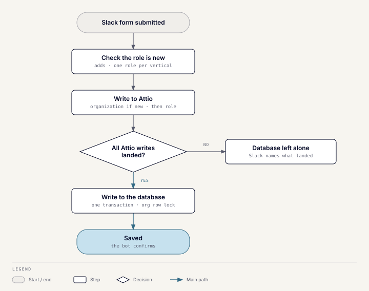

# Profile commands

## What it does

`/add-buyer`, `/add-seller`, `/edit-buyer`, and `/edit-seller` create and update
buyer and seller roles, and their organizations, from Slack. The same write
path serves seller discovery and enrichment, so every CRM change from the
Toolkit follows these rules.

## Edit flow

1. A fuzzy search finds the organization; several matches open a picker.
2. **Buyers only:** pick a vertical. An organization holds one buyer role per
   vertical, so an existing vertical edits that role and an unused one opens
   the add form.
3. A field picker lists the editable organization and role fields.
4. The edit form shows only the picked fields, prefilled.
5. Submit writes to Attio first, then the database, in the same request.

## Add flow

1. A fuzzy search looks for an existing organization. The user attaches the
   role to one or creates a new organization; the form warns about likely
   duplicates but doesn't block.
2. **Buyers only:** pick a vertical, as above. The vertical is set here only,
   so a role can't be moved onto a vertical another role holds.
3. The add form shows every eligible field. Only a new organization's name
   is required.
4. Submit writes the organization (if new) and the role to Attio, then to the
   database in one transaction.

## How a save is written

Each command also writes a `command_runs` row before its Attio writes
start, and finishes it as succeeded, failed, or partial. The row lists the
Attio writes that landed and the names of the fields changed, never their
values. A save that succeeds also records a `seller.added`, `seller.edited`,
`buyer.added`, or `buyer.edited` activity for the Slack user. If the ledger
write fails, the command still runs.

## Why Attio first

A scheduled sync copies Attio into the database. A change written only to the
database would be overwritten by the next sync. Writing Attio first means the
sync's source already agrees with what the database stores.

## Deletions

Records are deleted only in Attio. The database mirrors the deletion as a soft
delete: the row gets a `removed_at` timestamp, and a re-created record comes
back live. Rows are never hard-deleted, because related matches, notes, and
tool runs reference them. There are no remove commands; they were built once
and deliberately reverted.

## Fields Slack can't edit

- System-managed: connection strength and the active flag.
- Also written by pipelines, so a Slack edit could be overwritten:
  readiness and lead-quality scores, acquisition enrichment, and deals
  introduced or converted.
- Reference fields with no picker yet: a buyer's key contact and an
  organization's owner.
- Not built yet: the readiness band, key personnel, and last interaction
  date. Of the organization multi-selects, only sector focus is editable;
  type, stage focus, geographic focus, and categories aren't.

## Failure behavior

- If Attio fails before anything is written, the database is untouched.
- If part of the Attio write succeeded, the Slack message names exactly what
  was saved.
- If the role write fails after a new organization was created, the
  organization stays; the next add finds it.
- Two adds for the same organization are serialized by a row lock, so the
  second sees the first's role. The losing request may still leave a
  duplicate entry in Attio, which the next sync demotes.
- Anyone in the channel can run these commands; there is no allowlist.

## Bulk upload

Claude can upload a list of buyers or sellers, for example 140 rows from
a research run. The person approves in Claude. Nothing is created before that.

1. **Preview.** The list is checked and compared with the CRM, and nothing is
   written. The result gives the number of new, existing and invalid rows, the
   problem on each invalid row, and a preview id. A list holds 1 to 1,000 rows.
2. **Commit.** After the person confirms, the new rows are added in the
   background, one at a time. Each row is written like `/add-buyer` and
   `/add-seller` write it: Attio first, then the database.
3. **Status.** Shows how many rows were added, and which were skipped or failed,
   with the reason.

Each row needs a company name and a website or domain. Buyer rows also need a
target vertical. A row with an unknown field, or a value outside a field's
options, is marked invalid so no data is dropped silently.

A row counts as existing when its domain matches an organization that already
has the role. For buyers that means a role for the same vertical. For sellers it
means any active role. Existing rows are skipped and never change the record. The domain must match
exactly: `shop.acme.com` does not match `acme.com`. Each row is checked
again just before it is added, so a rerun adds only the rows still missing.
Added rows appear in the command log and the activity feed with source `mcp`.

Previews are kept in memory for an hour. If the server restarts, upload the
list again; rows already added are skipped.

## Code

`server/app/modules/ddl_commands` and its README. The nightly full resync job
is in the module's `scripts` folder.
