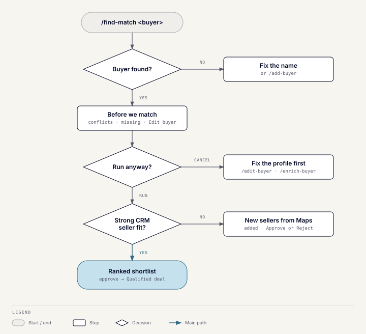

# Find matches

This page covers `/find-match`. For the other commands, see
[Wusool Toolkit](toolkit.md).

1. Run `/find-match <buyer name>`, for example `/find-match Raoof Capital`.
2. If several buyers have similar names, select the intended record.
3. In the **Before we match** popup, choose **Run anyway**. If details are
   missing, press **Edit buyer** to fill just those fields in without leaving
   Slack. While it saves, **Run anyway** is hidden. When the save ends, the
   popup checks the buyer again and shows what is still missing. Press
   **Cancel** to stop.
4. Use **View Full Analysis** to inspect a seller's reasoning, then choose
   **Approve Match** or **Reject Match**.

**Expected result:** a ranked shortlist with fit and data-confidence scores.

**Anything specific about this search?** What you type there outranks the
buyer's stored details. Name the business you want and put the modifier first.
"AI asset managers" finds asset or wealth managers and ranks AI ones higher.
"AI tools for asset managers" looks for AI companies serving them. Places,
ticket sizes ("ticket 5 to 10M") and exclusions ("not crypto") work too. If no
CRM seller fits, the bot says so and searches Google Maps instead of showing
sellers with no sector data.

## What your note can control

| You can set | Example | Effect |
|---|---|---|
| Business type | "AI asset managers" | Required sector. Modifiers such as AI only rank higher. |
| Places | "Saudi Arabia only", "UAE and Egypt" | Required geography. |
| Exclusions | "not crypto", "avoid real estate" | Removes sellers in that sector. |
| Revenue or EBITDA floor | "revenue above 5M" | Removes sellers below it. Sellers with no figure stay. |
| Ticket size | "ticket 5 to 10M" | Lowers the score of sellers outside the range. |
| Enterprise value cap | "EV below 50M" | Removes sellers above it. |
| Seller status | "Tier 1 sellers only" | Matches the seller's outreach tier, appetite signal or relationship status. |

Qualities such as founder background, runway or profitability appear in the
written explanation only. They don't change which sellers are shown or their
order.

The note can't change these:

- The shortlist is always three sellers.
- Google Maps search starts when no seller scores 50 or more.
- Each search adds up to five new sellers.
- Each buyer gets at most ten searches a day.
- Sellers already rejected for this buyer and vertical stay out.

**Approve Match** creates a Qualified Buy-side deal in Attio for that buyer
and seller. If an Inbound deal already exists for the pair, the bot asks
whether to promote it to Qualified or create a new one. An approval can't be
undone from Slack; ask the CRM owner to change the deal in Attio. Matching
never contacts an organization.

**Reject Match** keeps that seller out of later matches for the same buyer
and vertical. It still appears for other buyers, and the seller stays in
the CRM. A rejection can't be undone from Slack.

## When no CRM seller is a strong fit

The bot searches Google Maps for new sellers in the buyer's target regions
and countries:

- Each search writes up to five new sellers. It checks the Google Maps
  results in order and keeps going until it has five or runs out.
- A lead is saved automatically when its researched details match its Google
  Maps website. It is also saved when there are no extra details to check.
- A lead whose researched website doesn't match is skipped, and the result
  message says how many. Nothing is written for it.
- A lead whose name resembles a company already in the CRM is skipped too,
  and the message counts those. If one was really a different company, add
  it with `/add-seller`.
- A lead already waiting on an older **Website check** message is skipped for
  30 days. Those older messages still work.
- Pages on Instagram, Facebook, Shopify, Salla, Zid, or Google Sites count
  as "no website".

## Find matches on the web

The same flow runs in a browser at `/app` on the Toolkit host, for example
`https://tools.wusoolcapital.com/app` in production.

1. Enter the team access key. It is kept for that browser tab only; ask the
   Toolkit owner for it.
2. Type the buyer's name and pick the record with the mouse or the arrow keys
   and Enter.
3. Add your note about the search, if any, then **Check profile**. Missing or
   conflicting details show here. **Run match** starts the run; **Skip check
   and run** skips the check.
4. The steps bar at the top shows where the run is. Matching usually takes
   under a minute, and the page updates by itself.
5. Approve or reject each seller. Open **Full reasoning** for the pitch and
   the risks. If Attio already has a deal for the pair, choose **Use this
   deal** or **Create a new deal**.
6. If no seller scores 50 or more, the Google Maps search starts by itself
   and new sellers appear under **Discovery** for review.
7. **Download CSV** saves the shortlist with every decision so far.

The web version differs from Slack in a few ways:

- Approvals and rejections are recorded as made from the web app, not by
  your Slack name, until sign-in with Slack arrives.
- **Recent runs** in the sidebar lists runs started on that device only.
- To fill in missing buyer details, use `/edit-buyer` in Slack, then check
  again. The other commands are Slack-only for now.
- If the Toolkit restarts during a run, the page says the run never finished.
  Start a new one.

## If matching does not work

- **Buyer not found:** use the exact Attio name or add it with `/add-buyer`.
- **Thin or low-confidence result:** run `/enrich-buyer` or
  `/enrich-seller`, review the proposal, and match again.
- **Unexpected countries in web leads:** set the buyer's target regions or
  countries with `/edit-buyer`.
- **Error or timeout:** check `/toolkit-status`, then see
  [Troubleshooting](troubleshooting.md).
