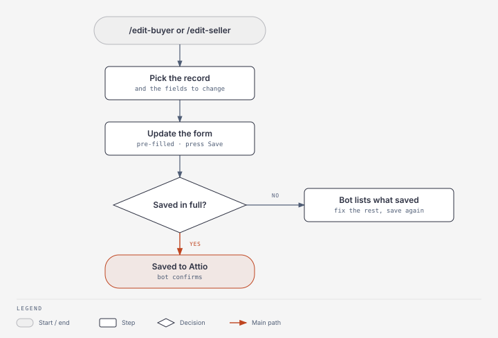
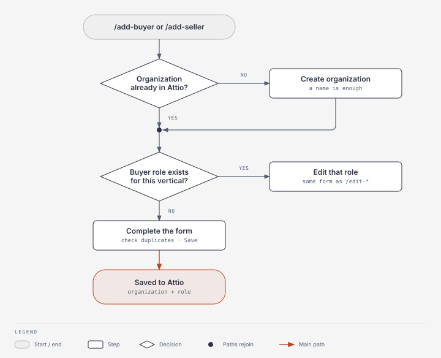
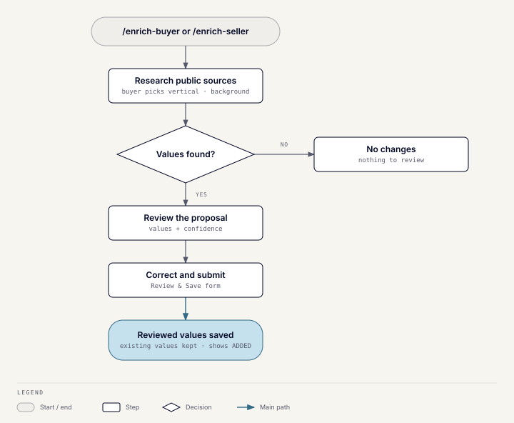

# Wusool Toolkit

Wusool Toolkit is the deal team's Slack bot. Use it to find buyer–seller
matches, maintain buyer and seller profiles, and research missing details.
Its scores and research are decision support; always check the result.

## Before you start

- Use the bot in a channel it's in (add it with `/invite @Wusool Toolkit`).
  It doesn't work in direct messages.
- Type `/toolkit-help` to see the available commands.

| Command | Result |
| --- | --- |
| `/find-match <buyer name>` | Ranked seller shortlist |
| `/check-buyer <buyer name>` | Checks the buyer's profile for conflicts or missing details |
| `/edit-seller <name>` / `/edit-buyer <name>` | Edit an existing profile |
| `/add-seller <organization>` / `/add-buyer <organization>` | Add a role |
| `/bulk-seller` / `/bulk-buyer` | Add many roles from a CSV or Excel file |
| `/enrich-seller <name>` / `/enrich-buyer <name>` | Propose missing values |
| `/toolkit-status` | Checks the bot is healthy |
| `/toolkit-help` | Command help |

## Check a buyer before matching

1. Run `/check-buyer <buyer name>` and confirm the buyer.
2. Optionally describe what this search is for, for example
   `pharma tech only, UAE, $5-15M ticket`.

**Expected result:** a popup lists **conflicts** with the buyer's profile and
**missing details**, each naming the `/edit-buyer` field to fix. It ends with
how your note was read, as a short list such as "Sector: Pharmaceuticals /
Biotech" and "Country: United Arab Emirates".

How your note is read:

- An amount counts as a ticket size only when you label it: "ticket",
  "check size", "investment", or "deal size".
- Open-ended amounts such as "at least $2M" conflict only when they can't
  overlap the buyer's range.
- The check compares four things with the buyer profile: sector, geography,
  ticket size, and EBITDA.
- It doesn't flag exclusions such as "no pharma", or an EV cap, revenue,
  seller status, or a modifier such as "AI". The match applies them, and the
  list shows each one it read.
- Geography uses the buyer's target regions and target countries together.

`/find-match` runs the same check before every match.

For `/find-match`, see [Find matches](toolkit-find-match.md).

## Maintain buyer and seller records

### Edit an existing profile

1. Run `/edit-seller <name>` or `/edit-buyer <name>` and select the intended
   record if asked.
2. For a buyer, pick a vertical. An existing one edits that role.
3. Tick only the organization or profile fields you need to change.
4. Continue to the pre-filled form, update the values, and press **Save**.

**Expected result:** the bot confirms the update once it is saved to Attio.
If only part of it saved, the bot says which part.

Scores, pipeline values, and people references can't be edited from Slack.

### Add a buyer or seller

1. Run `/add-seller <organization name>` or `/add-buyer <organization name>`.
2. Select an existing organization if it is the same business. Otherwise
   choose **None of these — create new organization**.
3. For a buyer, pick a vertical. An organization can hold one buyer role per
   vertical: an existing one edits that role, and an unused one creates a new
   role.
4. Complete the form. A new organization only needs a name; other fields can
   be filled later.
5. Review duplicate warnings and press **Save**.

**Expected result:** the organization and role appear in Attio.

There is no `/remove-seller` or `/remove-buyer`. Ask the CRM owner to remove
a role in Attio.

## Research missing details

1. Run `/enrich-seller <name>` or `/enrich-buyer <name>` and select the
   intended record if asked. For a buyer, pick the organization, then the
   vertical. A buyer with one vertical skips that step.
2. The bot researches public company sources and lists proposed values with
   confidence levels.
3. Press **Review & Save**, correct or clear anything you don't want, and
   submit the normal edit form. Once saved, the button changes to
   "✅ ADDED by" with your name.

**Expected result:** only reviewed values are saved. Fields that already
have a value are never overwritten.

If LinkedIn is switched on, a reply appears in the proposal's thread with the
organization's recent LinkedIn posts. It is information only; no CRM field is
changed. A re-run shows only what is new. The reply always says how the scan
went: new posts, no new posts, skipped, or failed. The organization needs a
LinkedIn page saved in the CRM, or the scan is skipped.
